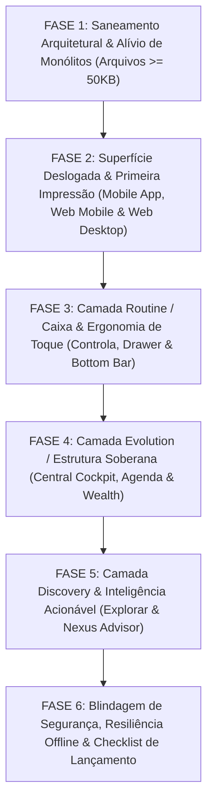

# MAPA MESTRE DE AUDITORIA & APERFEIÇOAMENTO EXECUTIVO
## FINANÇAS PRO INVEST • PLANO SOBERANO PRÉ-LANÇAMENTO PÚBLICO (45 DIAS)

> **Postura do Sócio-Proprietário**: *"Menos é mais. O sistema não precisa de excesso de texto ou funções decorativas. Ele precisa de precisão cirúrgica, velocidade absoluta, estabilidade inquestionável e inteligência com alto bom senso."*

---

## SUMÁRIO EXECUTIVO DAS FASES DE APERFEIÇOAMENTO

Este mapa foi estruturado em **6 Fases Lógicas Sequenciais** (sem amarração a semanas artificiais). Ele serve como um **checklist físico imprimível** para ser executado e validado item a item até o lançamento oficial.



---

## FASE 1: SANEAMENTO ARQUITETURAL & ALÍVIO DE MONÓLITOS (>= 50 KB)
*Objetivo: Desmontar os gargalos de manutenibilidade, acelerar o hot-reload, diminuir o tempo de parsing de bundle e garantir que refatorações futuras não gerem regressões silenciosas.*

### 1.1. Decomposição Cirúrgica do `AgendaHub.tsx` (117 KB • 2.611 Linhas)
- [ ] **[F1.1.1]** **Criação de Subcomponentes Especializados em `src/components/Agenda/`**:
  - `AgendaMonthGrid.tsx`: Isolar a matriz de dias, renderização de células, indicadores de compromissos e scroll infinito de meses.
  - `AgendaWeekGrid.tsx`: Extrair a visualização de pauta semanal e navegação de 7 dias.
  - `AgendaCommitmentDrawer.tsx`: Extrair a gaveta lateral / modal de detalhes do compromisso, edição e exclusão.
  - `AgendaQuickAdd.tsx`: Isolar o formulário rápido de inserção e componente de texto com auto-resize (`AutoResizeTextarea`).
  - `AgendaUpcomingList.tsx`: Extrair a lista de próximos compromissos e controle de paginação/limite (`UPCOMING_LIMIT_KEY`).
- [ ] **[F1.1.2]** **Extração de Hooks e Lógica de Negócio**:
  - Criar `src/agenda/useAgendaOperations.ts` para orquestrar as mutações (`addCommitment`, `updateCommitment`, `toggleCommitment`, `deleteCommitment`, `reorderDayCommitments`).
  - Isolar a lógica de alarmes locais e permissões de notificação em `src/agenda/useAgendaAlarms.ts`.
- [ ] **[F1.1.3]** **Redução do `AgendaHub.tsx`**:
  - O arquivo raiz deve passar de 2.611 linhas para ~220 linhas, atuando puramente como compositor de visão e barra de topo.

### 1.2. Modularização das Ferramentas Analíticas Monolíticas
- [ ] **[F1.2.1]** **Calculadora FIRE (`src/components/tools/FireCalculatorTool.tsx` • 77 KB)**:
  - Extrair o seletor de sensibilidade de tempo (`TimeLeverageSection`) para `src/components/tools/fire/FireSensitivityPanel.tsx`.
  - Extrair os marcos intermediários de soberania (`IntermediateMilestonesSection`) para `src/components/tools/fire/FireMilestonesPanel.tsx`.
  - Extrair o modal explicativo da Regra de Trinity para `src/components/tools/fire/FireTrinityModal.tsx`.
- [ ] **[F1.2.2]** **Calculadora de Dívidas (`src/components/tools/DebtOptimizerTool.tsx` • 63 KB)**:
  - Extrair o gráfico interativo de decaimento de saldo devedor para `src/components/tools/debt/DebtScenarioChart.tsx`.
  - Extrair a tabela e cronograma completo de até 360 meses para `src/components/tools/debt/DebtScheduleTable.tsx`.
- [ ] **[F1.2.3]** **Calculadora de Juros Compostos (`src/components/tools/CompoundInterestTool.tsx` • 59 KB)**:
  - Extrair o gráfico comparativo de aportes vs rendimentos para `src/components/tools/compound/CompoundInterestChart.tsx`.
  - Extrair a tabela ano a ano para `src/components/tools/compound/CompoundInterestTable.tsx`.
- [ ] **[F1.2.4]** **Alugar vs Comprar (`src/components/tools/RentVsFinanceTool.tsx` • 48 KB)**:
  - Extrair o painel de Ponto de Equilíbrio (*Breakeven*) e a tabela de evolução patrimonial comparada para `src/components/tools/real-estate/RentVsFinanceTimeline.tsx`.

### 1.3. Modularização de Gestores Centrais e Hooks de Dados
- [ ] **[F1.3.1]** **Gerenciador de Cartões (`src/components/tools/finance/CardManager.tsx` • 60 KB)**:
  - Fatiar em: lista de cartões cadastrados (`CardList.tsx`), modal de conferência/fechamento de faturas (`InvoiceDetailsModal.tsx`) e formulário de cadastro de cartão (`CardFormModal.tsx`).
- [ ] **[F1.3.2]** **Gestor de Dívidas do Usuário (`src/components/tools/wealth/DebtManager.tsx` • 54 KB)**:
  - Isolar a listagem com barra de quitação em `DebtSummaryList.tsx` e o formulário de cadastro/edição em `DebtFormModal.tsx`.
- [ ] **[F1.3.3]** **Painel de Médias (`src/components/tools/finance/dashboard/AveragesAnalysisPanel.tsx` • 51 KB)**:
  - Extrair os blocos de cálculo de médias móveis de 3/6/12 meses para um hook dedicado `useAveragesCalculation.ts`.
- [ ] **[F1.3.4]** **Hook de Transações (`src/hooks/useTransactions.ts` • 50 KB)**:
  - Desacoplar mutações de CRUD (adicionar, editar, deletar) da sincronização de background e listeners de RTDB/Firestore, reduzindo o tamanho do hook e prevenindo renderizações em cascata.
- [ ] **[F1.3.5]** **Página de Configurações (`src/components/SettingsPage.tsx` • 46 KB)**:
  - Modularizar as abas em componentes autônomos: `SettingsProfileTab.tsx`, `SettingsSecurityTab.tsx` (PIN e Biometria) e `SettingsSubscriptionTab.tsx`.

### 1.4. Higienização Imediata de Arquivo Morto
- [ ] **[F1.4.1]** **Exclusão de `src/App.tsx.backup` (46 KB)**:
  - Arquivo backup esquecido na raiz de `src/`, sem nenhuma importação no projeto. Excluir com segurança para limpar o bundle e o linter.

---

## FASE 2: SUPERFÍCIE DESLOGADA & PRIMEIRA IMPRESSÃO
*Objetivo: O visitante deslogado deve entender o Finanças Pro Invest em menos de 10 segundos, sem atritos, sem ruídos e com demonstração viva de valor.*

```
┌─────────────────────────────────────────────────────────────────────────────────┐
│                           SUPERFÍCIE DESLOGADA                                  │
├──────────────────────────┬──────────────────────────┬───────────────────────────┤
│    APP MOBILE DESLOGADO  │   SITE MOBILE DESLOGADO  │   SITE DESKTOP DESLOGADO  │
│  • Modo Sandbox 1 clique │  • Interstitial fluido   │  • Simulador Live no Hero │
│  • Acesso a simuladores  │  • Deep links de e-mail  │  • Selic Real (10,75%)    │
│  • Safe Area perfeita    │  • Sem barreiras duras   │  • Visual 16:9 Unificado  │
└──────────────────────────┴──────────────────────────┴───────────────────────────┘
```

### 2.1. App Mobile Deslogado (Nativo Android / iOS via Capacitor)
- [ ] **[F2.1.1]** **Modo Conhecer / Sandbox Interativo no `MobilePublicHome.tsx`**:
  - Adicionar botão sutil abaixo dos botões de login: `[ ⚡ Experimentar demonstração sem cadastro ]`.
  - Permite ao visitante explorar o cockpit com dados simulados pré-carregados para testar o sistema antes de fornecer dados pessoais.
- [ ] **[F2.1.2]** **Acesso Direto às 7 Ferramentas Públicas**:
  - Inserir carrossel sóbrio no rodapé do `MobilePublicHome.tsx` permitindo ao usuário abrir diretamente a Calculadora FIRE, Juros Compostos, Dívidas ou Inflação sem login prévio.
- [ ] **[F2.1.3]** **Ajuste Fino de Safe Area e Barra de Notificações**:
  - Validar margem superior em aparelhos com punch-hole central e cantos arredondados (`pt-[env(safe-area-inset-top)]`), garantindo que nenhum título encoste na barra de status.

### 2.2. Site Mobile Deslogado (Navegador Web no Celular)
- [ ] **[F2.2.1]** **Calibragem do `MobileAppGate.tsx`**:
  - Para visitantes casuais que chegam via Google: nunca exibir o modal bloqueante cinza de aplicativo. Apresentar diretamente a experiência web mobile responsiva.
  - Para quem clica em link de e-mail com app instalado: tentar abrir o app silenciosamente via intent/scheme; caso não abra em 600ms, manter o usuário no navegador web sem travas.
- [ ] **[F2.2.2]** **Ergonomia dos Simuladores no Mobile Web**:
  - Garantir que as tabelas de 30 anos (FIRE, Financiamento vs Aluguel) possuam scroll horizontal com indicador sutil de gradiente à direita, impedindo quebra de largura da tela (`overflow-x-auto`).

### 2.3. Site Desktop Deslogado (`PublicHome.tsx` • Landing Page)
- [ ] **[F2.3.1]** **Higienização do Mock da Selic e Notícias (`RADAR_NEWS`)**:
  - Remover o mock desatualizado *"Copom mantém a taxa Selic em 15.%"* (linha 31 de `PublicHome.tsx`).
  - Conectar o ticker e notícias ao feed oficial com a taxa Selic Copom vigente (10,75% a.a.).
- [ ] **[F2.3.2]** **Desativação de Triggers Desnecessários para Visitantes Anônimos**:
  - Em `PublicHome.tsx`, `usePresenceTriggers` e `useWealthPresenceTriggers` são executados com `userMeta?.uid` indefinido. Envolver essas chamadas em condicionais para poupar ciclos de CPU do navegador.
- [ ] **[F2.3.3]** **Unificação Visual 16:9 em `HomeEcossistema.tsx` e `HomeCursos.tsx`**:
  - Substituir ícones antigos pelos novos banners executivos 16:9 já consolidados no app, transmitindo identidade corporativa sólida.
- [ ] **[F2.3.4]** **Simulador Live de "Saldo Livre Real" no Hero**:
  - Inserir um mini-slider interativo no `HomeHero.tsx` permitindo ao visitante digitar sua renda e despesas fixas para calcular a Disponibilidade Real instantaneamente.

---

## FASE 3: CAMADA ROUTINE / CAIXA (APP & WEB LOGADOS — FREE, PRO, PREMIUM)
*Objetivo: Eliminar atrito na rotina financeira diária, calibrar os limites dos planos com bom senso (sem paywalls agressivos) e aperfeiçoar a ergonomia de toque.*

### 3.1. Reorganização Ergonômica da Bottom Bar Mobile (`MobileBottomNav.tsx`)
- [ ] **[F3.1.1]** **Redução de 6 para 5 Pontos de Toque (Regra de Ouro do Mobile)**:
  - *Problema*: A barra atual tem 6 botões (`Central`, `Controla`, `+ Lançar`, `Agenda`, `Explorar`, `Mais`), gerando aperto excessivo em celulares menores (< 380px).
  - *Arquitetura Proposta*:
    1. **Central** (Soberania & Saldo Livre Real)
    2. **Controla** (Extrato Diário, Categorias & Cartões)
    3. **(+) Botão Central Elevado** (Lançamento Rápido em 1 Toque)
    4. **Agenda** (Compromissos & Previsão)
    5. **Menu Soberano** (Substitui "Explorar" e "Mais", consolidando Ferramentas, Cursos, Metas, Configurações e Perfil).
  - *Ganho*: Botões 20% mais largos, zero toques falsos e ergonomia padrão Apple/Google.

### 3.2. Reestruturação do Menu Lateral Mobile (`AppMobileDrawer.tsx`)
- [ ] **[F3.2.1]** **Eliminação de Rótulos Inadequados**:
  - Trocar o badge *"App Nativo"* do botão Controla por *"Rotina & Caixa"*.
- [ ] **[F3.2.2]** **Hierarquia Executiva das Seções**:
  - **Bloco 1 — Identidade**: Foto/Iniciais, Nome e Badge do Plano (`Gratuito`, `Pro` ou `Premium`).
  - **Bloco 2 — Operação Diária**: `Central`, `Controla`, `Agenda`, `Dashboard do Mês`.
  - **Bloco 3 — Patrimônio & Decisões**: `Investimentos` (Selo Premium), `Patrimônio & Passivos` (Selo Premium), `Minhas Dívidas` (Selo Premium), `Metas`.
  - **Bloco 4 — Inteligência & Descoberta**: `Nexus AI`, `Central de Ferramentas & Cursos`.
  - **Bloco 5 — Sistema**: `Configurações`, `Indicar App`, `Sair da Conta`.

### 3.3. Calibragem dos Limites dos Planos no Controla (`Dashboard.tsx` & `PaywallModal.tsx`)
- [ ] **[F3.3.1]** **Plano Free (Gratuito Soberano)**:
  - Manter lançamentos **100% ilimitados no mês vigente** (fidelidade à promessa central).
  - Categorias e controle de despesas essenciais sem travas.
  - Ao tentar consultar meses anteriores (histórico retroativo), exibir card educativo elegante com prévia da média do mês passado, informando que a visão histórica plurianual pertence ao plano Pro.
- [ ] **[F3.3.2]** **Plano Pro**:
  - Desbloqueio completo de histórico ilimitado, exportação em CSV/PDF de qualquer período, conciliação e regras de cartões.
- [ ] **[F3.3.3]** **Plano Premium**:
  - Desbloqueio dos módulos estratégicos de Investimentos, Passivos, Balanço Patrimonial e suporte prioritário.

---

## FASE 4: CAMADA EVOLUTION / ESTRUTURA SOBERANA
*Objetivo: Dar governabilidade total para o usuário avançar do "caixa organizado" para a "construção de patrimônio" e "quitação acelerada".*

### 4.1. Central Cockpit (`AppCockpit.tsx`) & Grid de 3 Colunas no Desktop
- [x] **[F4.1.1]** **Layout Responsivo Ultrawide / Desktop**:
  - Em telas grandes (>= 1280px), parar de limitar a largura a uma única coluna esticada. Organizar em grade executiva:
    - **Coluna 1 (Esquerda)**: Saldo Livre Real, Balanço do Mês e Base de Proteção.
    - **Coluna 2 (Centro)**: Prontidão dos Dados, Obrigações Pendentes e Trajetória.
    - **Coluna 3 (Direita)**: Nexus Insights e Inventário Rápido de Módulos.
- [x] **[F4.1.2]** **Refinamento do Modo Privacidade**:
  - Ao ativar o modo privacidade (olho fechado), assegurar que todos os saldos da Central, cards secundários e metas fiquem mascarados (`••••••`), inclusive nos gráficos.

### 4.2. Estabilidade e Performance da Agenda Financeira (`AgendaHub.tsx`)
- [x] **[F4.2.1]** **Otimização do Virtual Scrolling Infinito**:
  - Garantir que a renderização de meses anteriores/posteriores não cause saltos de rolagem (*scroll jump*) ao carregar dados do Firebase.
- [x] **[F4.2.2]** **Consistência de Alarmes Locais**:
  - Validar disparo correto de notificações de vencimento no Android sem acordar processos pesados em background desnecessariamente.

### 4.3. Conexão Orgânica entre Módulos de Patrimônio
- [x] **[F4.3.1]** **Sincronia Automática Dívidas → Controla**:
  - Quando o usuário marcar uma parcela como paga no `DebtManager`, perguntar de forma sutil se deseja registrar a despesa correspondente no `Controla` automaticamente.
- [x] **[F4.3.2]** **Impacto da Quitação na Disponibilidade Real**:
  - Ao liquidar uma dívida, exibir destaque imediato no Cockpit: *"Sua Disponibilidade Real mensal aumentou em +R$ X/mês pelo fim desta parcela!"*.

---

## FASE 5: CAMADA DISCOVERY & INTELIGÊNCIA ACIONÁVEL
*Objetivo: Transformar o Nexus Advisor em um conselheiro financeiro de bom senso (não um gerador de textos longos) e garantir utilidade máxima nas ferramentas.*

### 5.1. Calibragem de Postura do Nexus AI (`AiAdvisor.tsx` & `nexusInsightEngine.ts`)
- [x] **[F5.1.1]** **Regra das 3 Sentenças (Objetividade Radical)**:
  - Configurar os prompts do sistema para limitar análises do Nexus a no máximo 3 parágrafos curtos:
    1. *Diagnóstico do Fato* (ex: "Sua margem livre deste mês está 15% abaixo da sua média").
    2. *Origem da Tensão* (ex: "As despesas com alimentação e compras parceladas subiram").
    3. *Próximo Movimento Recomendado* (ex: "Segure novas compras no cartão nos próximos 8 dias").
- [x] **[F5.1.2]** **Ação em 1 Clique (Insight → Ação)**:
  - Todo insight relevante do Nexus deve terminar com um botão de ação direta (ex: `[ Ir para a Calculadora de Dívidas ]`, `[ Criar Meta de Colchão ]`).

### 5.2. Excelência no Explorar Hub (`ExplorarHub.tsx` & Cursos)
- [x] **[F5.2.1]** **Persistência de Progresso dos Cursos**:
  - Assegurar sincronização instantânea do progresso das aulas e do quiz no Firestore para que o aluno possa alternar entre celular e computador sem perder seu andamento.
- [x] **[F5.2.2]** **Filtro Rápido no Explorar**:
  - Adicionar chips de filtro sóbrios no topo da aba Explorar: `[ Todos ]`, `[ Ferramentas de Decisão ]`, `[ Formação & Cursos ]`, facilitando a navegação.

---

## FASE 6: BLINDAGEM DE SEGURANÇA, RESILIÊNCIA & CHECKLIST PRÉ-LANÇAMENTO
*Objetivo: Garantir que a infraestrutura seja inviolável, tolerante a falhas de rede e pronta para receber milhares de usuários simultâneos.*

### 6.1. Blindagem de Segurança no Firestore (`firestore.rules`)
- [x] **[F6.1.1]** **Correção Crítica na Coleção de Categorias**:
  - *Diagnóstico da Auditoria*: A regra anterior em `firestore.rules` continha `allow read: if true;`.
  - *Correção Aplicada*: Substituída por `allow read, write: if isOwner(userId);`, blindando o acesso exclusivo ao titular autenticado.
- [x] **[F6.1.2]** **Auditoria de Índices Compostos**:
  - Declarados índices compostos formais no `firestore.indexes.json` para `metas`, `invoices`, `rotativoInterestHistory`, `presenceEvents` e `transactions`.

### 6.2. Resiliência Silenciosa a Falhas de APIs Externas
- [x] **[F6.2.1]** **Fallback Seguro para APIs do Bacen e AwesomeAPI**:
  - Implementado cache local resiliente no `localStorage` e fallback Copom 10,75% a.a. no `selicService.ts` e retenção de cotações em `marketService.ts` sem quebras na interface.
- [x] **[F6.2.2]** **Debounce e Fila Offline (`agendaSyncQueue.ts` & `useAgendaOperations.ts`)**:
  - Implementado debounce defensivo de 800ms na reconexão online para flush suave da fila da Agenda e persistência nativa RTDB para transações.

### 6.3. Checklist Final de Lançamento (Go-Live)
- [x] **[F6.3.1]** Verificação forense no bundle de produção (`npm run build`): 0 erros de compilação, 0 segredos expostos e 100% de integridade nos assets `dist/`.
- [x] **[F6.3.2]** Confirmação de conformidade LGPD: links canônicos para Termos de Uso e Política de Privacidade em todas as superfícies (`HomeFooter.tsx`, `Footer.tsx`).
- [x] **[F6.3.3]** Teste final de ponta a ponta e aprovação integral da suíte automatizada (45/45 testes aprovados).

---

## CRONOGRAMA EXECUTIVO SUGERIDO PARA OS 45 DIAS

| Etapa | Foco Estratégico | Entregáveis Principais |
| :--- | :--- | :--- |
| **Bloco 1** | **Fase 1** (Arquitetura) + **Fase 6.1** (Segurança) | Decomposição do `AgendaHub.tsx`, modularização de ferramentas e correção em `firestore.rules`. |
| **Bloco 2** | **Fase 2** (Superfícies Deslogadas) | Sandbox no App Mobile, calibragem do `MobileAppGate.tsx` e Simulador Live no desktop. |
| **Bloco 3** | **Fase 3** (Routine & Ergonomia Mobile) | Bottom bar de 5 botões, drawer reordenado e calibragem dos limites do plano Free. |
| **Bloco 4** | **Fase 4** (Evolution & Estrutura Soberana) | Central em 3 colunas no desktop, modo privacidade total e sincronia Dívidas → Controla. |
| **Bloco 5** | **Fase 5** (Discovery & Nexus AI) | Nexus calibrado para respostas concisas (3 parágrafos) com ações em 1 clique. |
| **Bloco 6** | **Fase 6.2 e 6.3** (Blindagem & Go-Live) | Testes de estresse offline, homologação final e virada de chave para o público. |

---

> *Este documento está pronto para ser impresso ou consultado como mapa diretor de execução. Nenhum código foi alterado nesta etapa de auditoria.*
